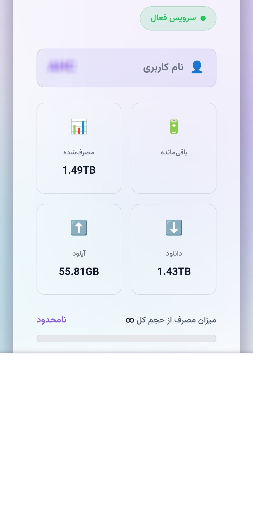
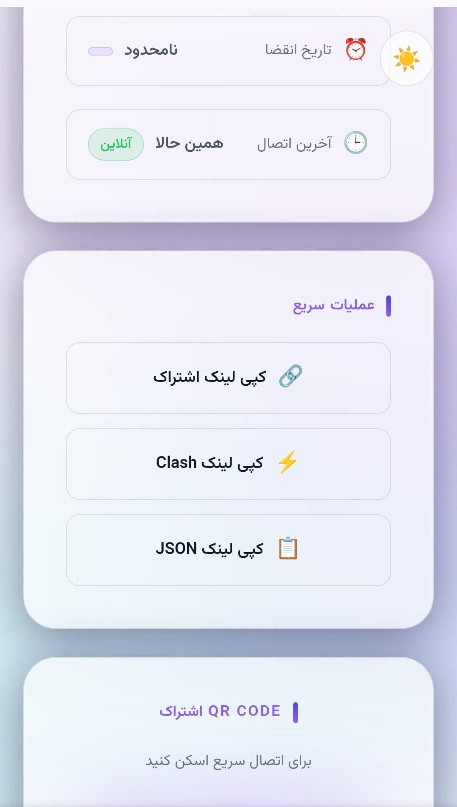
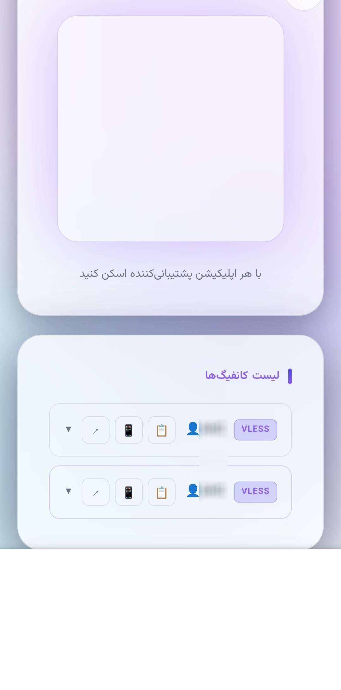
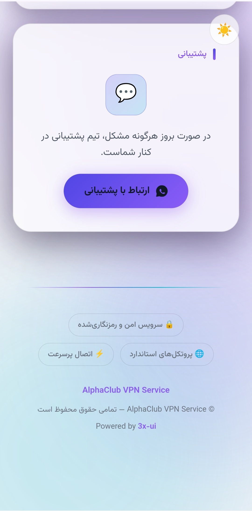

# alpha-sub-templates

Modern, multi-language subscription page templates for **3x-ui**. Dark glass design, responsive layout, and support for Happ & Incy.

[فارسی](#فارسی)

---

## Preview

<p align="center">
  
</p>

<details>
  <summary><strong>View mobile screenshots</strong></summary>
  <br>
  <table>
    <tr>
      <td align="center">
        
      </td>
      <td align="center">
        
      </td>
      <td align="center">
        
      </td>
    </tr>
    <tr>
      <td align="center">
        
      </td>
      <td align="center" colspan="2">
        
      </td>
    </tr>
  </table>
</details>

## Features

- Multi-language interface: Persian, Arabic, Turkish, Russian, and English
- Full RTL support for Persian and Arabic, with LTR layouts for other languages
- Responsive design for desktop and mobile
- Usage statistics and progress bar (used / remaining / total)
- Expiry date displayed in the Shamsi (Jalali) calendar
- Last online time
- Status alerts for expired, data-exhausted, or disabled accounts
- One-tap copy for subscription, Clash, and JSON links
- QR code for the subscription link
- Configuration list with copy and QR actions
- Setup guides for Happ and Incy (Android, iOS, Windows, macOS)
- Support button connected to the support URL configured in your panel
- Uses 3x-ui template variables; no hardcoded domains or subscription links

## Supported languages

| Language | Code |
|---|---|
| فارسی (Persian) | `fa` |
| العربية (Arabic) | `ar` |
| Türkçe (Turkish) | `tr` |
| Русский (Russian) | `ru` |
| English | `en` |

## Installation

### Quick install

Run this command as `root` on the server where 3x-ui is installed:

```bash
bash <(curl -Ls https://raw.githubusercontent.com/alphaclubdev/alpha-sub-templates/main/install.sh)
```

Then, in the 3x-ui panel:

1. Open **Panel Settings → Subscription → Profile**.
2. Set **Sub Theme Directory** to:

   ```text
   /etc/3x-ui/sub_templates/glass-dark/
   ```

3. Save the settings and open a subscription link.

The server must be able to access GitHub. To install a specific template, append its folder name to the command:

```bash
bash <(curl -Ls https://raw.githubusercontent.com/alphaclubdev/alpha-sub-templates/main/install.sh) glass-dark
```

### Manual install

1. Download `index.html` from [`templates/glass-dark`](templates/glass-dark).
2. Upload it to `/etc/3x-ui/sub_templates/glass-dark/` on your server using SFTP or `scp`.
3. Set **Sub Theme Directory** in the 3x-ui panel to the path shown above.

### Update

Run the quick-install command again. The installer keeps the previous file as `index.html.bak`.

## Changelog

- **v1.1.1** — Replaced emoji-based UI symbols with SVG icons and improved the language selector with country flags.
- **v1.1.0** — Added the language switcher: Persian, Arabic, Turkish, Russian, and English.
- **v1.0.0** — First release of the `glass-dark` template.

## Available templates

| Template | Directory |
|---|---|
| glass-dark | [`templates/glass-dark`](templates/glass-dark) |

## Contributing

Issues and pull requests are welcome.

## License

[MIT](LICENSE)

---

<a name="فارسی"></a>

# فارسی

قالب‌های مدرن و چندزبانه‌ی صفحه‌ی اشتراک برای **3x-ui**؛ با طراحی شیشه‌ای تیره، چیدمان واکنش‌گرا و پشتیبانی از Happ و Incy.

## پیش‌نمایش

<p align="center">
  
</p>

<details>
  <summary><strong>مشاهده تصاویر نسخه موبایل</strong></summary>
  <br>
  <table>
    <tr>
      <td align="center">
        
      </td>
      <td align="center">
        
      </td>
      <td align="center">
        
      </td>
    </tr>
    <tr>
      <td align="center">
        
      </td>
      <td align="center" colspan="2">
        
      </td>
    </tr>
  </table>
</details>

## امکانات

- رابط کاربری چندزبانه: فارسی، عربی، ترکی استانبولی، روسی و انگلیسی
- پشتیبانی کامل از راست‌چین برای فارسی و عربی و چپ‌چین برای سایر زبان‌ها
- طراحی واکنش‌گرا برای موبایل و دسکتاپ
- نمایش آمار مصرف و نوار پیشرفت (مصرف‌شده / باقی‌مانده / حجم کل)
- نمایش تاریخ انقضا با تقویم شمسی
- نمایش آخرین زمان اتصال
- هشدار وضعیت برای اشتراک منقضی، اتمام حجم یا غیرفعال
- کپی سریع لینک اشتراک، Clash و JSON
- نمایش QR کد لینک اشتراک
- فهرست کانفیگ‌ها همراه با امکان کپی و نمایش QR
- راهنمای راه‌اندازی Happ و Incy برای اندروید، iOS، ویندوز و macOS
- دکمه پشتیبانی متصل به لینک پشتیبانی تنظیم‌شده در پنل
- استفاده از متغیرهای قالب 3x-ui، بدون دامنه یا لینک ثابت

## زبان‌های پشتیبانی‌شده

| زبان | کد |
|---|---|
| فارسی | `fa` |
| عربی | `ar` |
| ترکی استانبولی | `tr` |
| روسی | `ru` |
| انگلیسی | `en` |

## نصب

### نصب سریع

این دستور را با دسترسی `root` روی سروری که 3x-ui نصب است اجرا کن:

```bash
bash <(curl -Ls https://raw.githubusercontent.com/alphaclubdev/alpha-sub-templates/main/install.sh)
```

سپس در پنل 3x-ui:

1. وارد مسیر **Panel Settings → Subscription → Profile** شو.
2. مقدار **Sub Theme Directory** را روی مسیر زیر قرار بده:

   ```text
   /etc/3x-ui/sub_templates/glass-dark/
   ```

3. تنظیمات را ذخیره کن و یک لینک اشتراک را باز کن.

سرور باید به GitHub دسترسی داشته باشد. برای نصب یک قالب مشخص، نام پوشه آن را به انتهای دستور اضافه کن:

```bash
bash <(curl -Ls https://raw.githubusercontent.com/alphaclubdev/alpha-sub-templates/main/install.sh) glass-dark
```

### نصب دستی

1. فایل `index.html` را از پوشه [`templates/glass-dark`](templates/glass-dark) دانلود کن.
2. آن را با SFTP یا `scp` در مسیر `/etc/3x-ui/sub_templates/glass-dark/` روی سرور قرار بده.
3. مقدار **Sub Theme Directory** را در پنل 3x-ui روی همین مسیر تنظیم کن.

### به‌روزرسانی

دستور نصب سریع را دوباره اجرا کن. فایل قبلی با نام `index.html.bak` نگهداری می‌شود.

## تاریخچه تغییرات

- **v1.1.1** — جایگزینی نمادهای ایموجی با آیکون‌های SVG و بهبود انتخابگر زبان با پرچم کشورها.
- **v1.1.0** — اضافه شدن انتخابگر زبان: فارسی، عربی، ترکی استانبولی، روسی و انگلیسی.
- **v1.0.0** — اولین انتشار قالب `glass-dark`.

## قالب‌های موجود

| قالب | مسیر |
|---|---|
| glass-dark | [`templates/glass-dark`](templates/glass-dark) |

## مشارکت

برای گزارش مشکلات و ارسال درخواست‌های Pull Request خوشحال می‌شویم مشارکت کنی.

## مجوز

[MIT](LICENSE)
