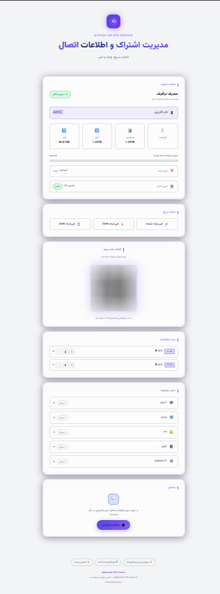
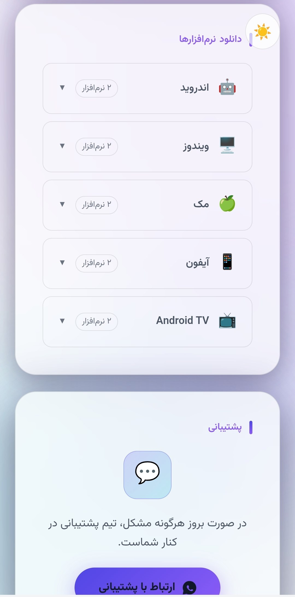

# alpha-sub-templates

Persian RTL subscription page templates for 3x-ui. Dark glass design, Happ & Incy ready.

[فارسی](#فارسی)

## Preview



<p align="center">
  
  
  
  
  
</p>

## Features

- Full Persian RTL layout, mobile-friendly
- Usage progress bar (used / remaining / total)
- Expiry date in the Shamsi (Jalali) calendar
- Last online time
- Status alerts: expired, data exhausted, disabled
- One-tap copy for subscription, Clash and JSON links
- QR code for the subscription link
- Config list with copy and QR
- Setup guide for Happ and Incy (Android, iOS, Windows, macOS)
- Support button linked to your panel's support URL
- Uses only 3x-ui template variables, no hardcoded domains or links

## Quick install

Run on the server where 3x-ui is installed (as root):

```bash
bash <(curl -Ls https://raw.githubusercontent.com/alphaclubdev/alpha-sub-templates/main/install.sh)
```

Then in the 3x-ui panel:

1. **Panel Settings** → **Subscription** → **Profile** tab
2. **Sub Theme Directory:** `/etc/3x-ui/sub_templates/glass-dark/`
3. Save, then open a subscription link.

The server needs access to GitHub. To install a specific template, pass its name:

```bash
bash <(curl -Ls https://raw.githubusercontent.com/alphaclubdev/alpha-sub-templates/main/install.sh) glass-dark
```

## Manual install

1. Download `index.html` from `templates/glass-dark`.
2. Upload it to `/etc/3x-ui/sub_templates/glass-dark/` on your server (SFTP / scp).
3. Set **Sub Theme Directory** in the panel as shown above.

## Update

Run the quick install command again. The previous file is saved as `index.html.bak`.

## Templates

| Template | Folder |
|----------|--------|
| glass-dark | [templates/glass-dark](templates/glass-dark) |

## Contributing

Issues and pull requests are welcome.

---

<a name="فارسی"></a>

# فارسی

قالب‌های فارسی راست‌چین صفحه‌ی اشتراک برای 3x-ui. طراحی شیشه‌ای تیره، آماده برای Happ و Incy.

## امکانات

- چیدمان کامل فارسی و راست‌چین، سازگار با موبایل
- نوار مصرف (مصرف‌شده / باقی‌مانده / کل)
- نمایش تاریخ انقضا به تقویم شمسی
- زمان آخرین اتصال
- هشدار وضعیت: منقضی، اتمام حجم، غیرفعال
- کپی سریع لینک ساب، Clash و JSON
- QR لینک اشتراک
- لیست کانفیگ‌ها با کپی و QR
- راهنمای نصب Happ و Incy (اندروید، iOS، ویندوز، مک)
- دکمه‌ی پشتیبانی متصل به لینک پشتیبانی پنل
- فقط از متغیرهای قالب 3x-ui استفاده می‌کند، بدون دامنه و لینک ثابت

## نصب سریع

روی سروری که 3x-ui نصب است (با کاربر root) اجرا کن:

```bash
bash <(curl -Ls https://raw.githubusercontent.com/alphaclubdev/alpha-sub-templates/main/install.sh)
```

سپس در پنل 3x-ui:

1. **Panel Settings** ← **Subscription** ← تب **Profile**
2. در **Sub Theme Directory** این آدرس را وارد کن: `/etc/3x-ui/sub_templates/glass-dark/`
3. ذخیره کن و یک لینک ساب را باز کن.

سرور باید به گیت‌هاب دسترسی داشته باشد. برای نصب یک قالب مشخص، اسمش را آخر دستور بنویس:

```bash
bash <(curl -Ls https://raw.githubusercontent.com/alphaclubdev/alpha-sub-templates/main/install.sh) glass-dark
```

## نصب دستی

۱. فایل `index.html` را از پوشه‌ی `templates/glass-dark` دانلود کن.
۲. آن را در مسیر `/etc/3x-ui/sub_templates/glass-dark/` روی سرور آپلود کن (SFTP / scp).
۳. مقدار **Sub Theme Directory** را در پنل مثل بالا تنظیم کن.

## به‌روزرسانی

دستور نصب سریع را دوباره اجرا کن. فایل قبلی با اسم `index.html.bak` نگه داشته می‌شود.

## مشارکت

گزارش مشکل (Issue) و درخواست ادغام (Pull Request) پذیرفته می‌شود.
